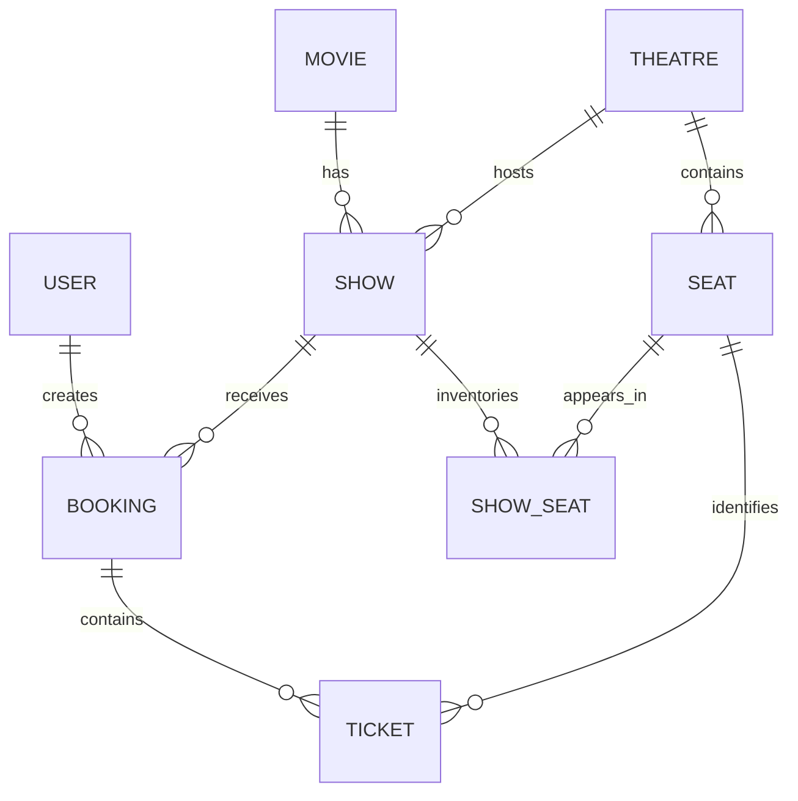

# Movie Ticket Booking Backend

A Java 21 / Spring Boot 4 REST API with MySQL, authenticated booking, cancellation,
barcode tickets, and automated tests against a real MySQL database.

## Features and architecture

- 12 application endpoints across 6 controllers and 8 JPA entities.
- BCrypt password hashing, one-hour signed JWTs, USER/ADMIN roles, and booking ownership checks.
- Show-specific inventory with a unique (show_id, seat_id) constraint.
- Transactional booking and pessimistic seat locks acquired in ascending seat-ID order.
- Cancellation locks the booking before checking status, is idempotent, and releases seats.
- Cancellation is allowed only before a show starts. Cancelled tickets no longer expose barcodes.
- Barcode requests have 2-second connect and 3-second read timeouts. Errors or empty responses roll back the whole booking.
- Decimal monetary values, enum statuses, validation, and centralized API error responses.
- Flyway migrations, Hibernate schema validation, Swagger/OpenAPI, health endpoints, Docker, and CI.

The application follows Controller -> Service -> Repository -> MySQL.
ShowSeat stores availability for one physical seat at one show; Seat describes the theatre layout.
The theatre-layout endpoint is not show-specific availability. Use /bookings/shows/{showId}/seats before booking.

## Quick start

Requirements: Java 21, MySQL 8.4, and Maven Wrapper; alternatively Docker with Compose.

### Docker demo

On PowerShell:

```powershell
./scripts/init-demo.ps1
docker compose up --build -d
```

On other shells, copy .env.example to .env and replace all placeholder secrets first.
The demo creates admin@example.test (password: DEMO_ADMIN_PASSWORD from your .env),
one movie, one theatre, one show for the next day, and 50 seats. Demo data is created only once.
Never commit .env.

- Swagger UI: http://localhost:8080/swagger-ui/index.html
- OpenAPI JSON: http://localhost:8080/v3/api-docs
- Health: http://localhost:8080/actuator/health

### Run with an existing local MySQL server

Create an empty movie_ticket_booking database. Set DB_URL, DB_USERNAME, DB_PASSWORD,
and JWT_SECRET (Base64 encoding of at least 32 random bytes).

```powershell
$env:DB_URL = "jdbc:mysql://localhost:3306/movie_ticket_booking"
$env:DB_USERNAME = "booking"
$env:DB_PASSWORD = "your-local-database-password"
$env:JWT_SECRET = "your-base64-encoded-random-key"
./mvnw.cmd spring-boot:run
```

Flyway creates the schema and Hibernate validates it. For a pre-existing untracked schema,
follow [the migration procedure](docs/DEPLOYMENT.md#existing-databases) before starting.
To enable sample data, additionally set SPRING_PROFILES_ACTIVE=demo and DEMO_ADMIN_PASSWORD.

## Authentication

Register with POST /users:

```json
{
  "name": "Example User",
  "email": "user@example.test",
  "phone": "9876543210",
  "password": "use-a-unique-long-password"
}
```

Passwords require 12–64 characters and at most 72 UTF-8 bytes. Email addresses are normalized.
Registration always assigns USER, regardless of submitted role fields.

POST /auth/login with:

```json
{
  "email": "user@example.test",
  "password": "use-a-unique-long-password"
}
```

Use the returned accessToken in an Authorization: Bearer <token> header.
In Swagger, click Authorize and paste the token. Use HTTPS outside localhost.

## API endpoints

| Method | Endpoint | Access | Purpose |
| --- | --- | --- | --- |
| POST | /users | Public | Register |
| POST | /auth/login | Public | Obtain bearer token |
| POST | /movies | ADMIN | Create movie |
| GET | /movies | Public | List movies |
| POST | /theatres | ADMIN | Create theatre and 50 seats |
| POST | /shows | ADMIN | Create show and inventory |
| GET | /shows/movie/{movieId} | Public | List movie shows |
| GET | /bookings/theatre/{theatreId}/seats | Public | Theatre layout |
| GET | /bookings/shows/{showId}/seats | Public | Show seat availability |
| POST | /bookings | Authenticated | Reserve 1–9 seats |
| GET | /bookings/{id} | Owner | Booking and ticket details |
| DELETE | /bookings/{id} | Owner | Cancel and release seats |

Framework, Swagger, and Actuator endpoints are excluded from this count.

Booking request:

```json
{
  "showId": 2,
  "seatIds": [10, 11]
}
```

The user comes from the verified token. A userId field in the request does not select the owner.
A successful booking returns bookingId, status, and totalAmount.
Repeated cancellation returns the existing CANCELLED booking without touching its former seats.

## Concurrency and rollback

Booking locks each ShowSeat row inside one transaction, checks availability after acquiring
the lock, and creates tickets. Competing requests cannot both reserve the same available row
through this flow. Locks are acquired in ascending seat-ID order to avoid inversions.

Cancellation first locks the Booking row. A second cancellation waits and then observes
CANCELLED, so it cannot release a seat subsequently reserved by someone else.
Cancellation locks show seats in the same ascending order.

The unique inventory constraint prevents duplicate show/seat rows. The transaction and locks
protect reservation state; the constraint alone does not validate active bookings.

Barcode generation happens inside the booking transaction. A provider exception, timeout,
or empty body causes a 502 response and rolls back booking, tickets, and seat updates together.
Flush does not commit. This deliberately favors atomicity, but holds database locks during the
bounded provider call; asynchronous ticket issuance would require a separate pending/retry design.

## Schema

Eight application tables: users, movie, theatre, shows, seat, show_seat, booking, ticket.
Flyway additionally maintains flyway_schema_history.



## Tests and CI

```powershell
./mvnw.cmd test
./mvnw.cmd verify
```

On Linux/macOS use bash ./mvnw test or bash ./mvnw verify.
The test phase runs 8 unit tests. Verify additionally runs 12 integration tests against an
isolated MySQL 8.4 Testcontainer, with a real HTTP server, JWT security, Flyway, and Hibernate.
Docker must be running; integration tests intentionally fail rather than silently skip without Docker.

Integration scenarios include competing bookings, opposite seat order, rollback after a later
barcode failure, empty barcode responses, cancellation/rebooking races, ownership, role restrictions,
password hashing, request validation, cancellation cutoff, Swagger, and health.
Barcode-service tests use a local HTTP server for success, empty responses, 503 responses, and timeouts.
Integration tests mock the barcode provider so they do not depend on external availability.

Reports: target/surefire-reports and target/failsafe-reports.
GitHub Actions runs verify and builds the Docker image on pushes and pull requests.

## Errors

400: invalid input or business rule; 401: missing/invalid authentication; 403: unauthorized resource;
404: missing resource; 409: reservation/database conflict; 502: barcode failure; 500: unexpected failure.

## Deployment and limitations

See [deployment and migration instructions](docs/DEPLOYMENT.md).
No public deployment URL is recorded yet. Add one only after deploying and verifying the demo.

Payments and refunds are not implemented. totalAmount is a calculated booking price, not evidence
that money was charged. Cancellation releases inventory; it does not issue a financial refund.
Token refresh, password reset, immediate token revocation, and login rate limiting remain future work.
Use an HTTPS gateway with rate limiting for a publicly accessible demo.

## Resume description

After running verify successfully:

> Built a Spring Boot/MySQL movie-ticket booking API with 12 endpoints and 8 JPA entities,
> implementing JWT authentication, ownership checks, transactional reservations, pessimistic locking,
> cancellation, barcode failure rollback, and automated MySQL integration tests.

Add deployment or performance claims only when you have a live deployment or measured results.
