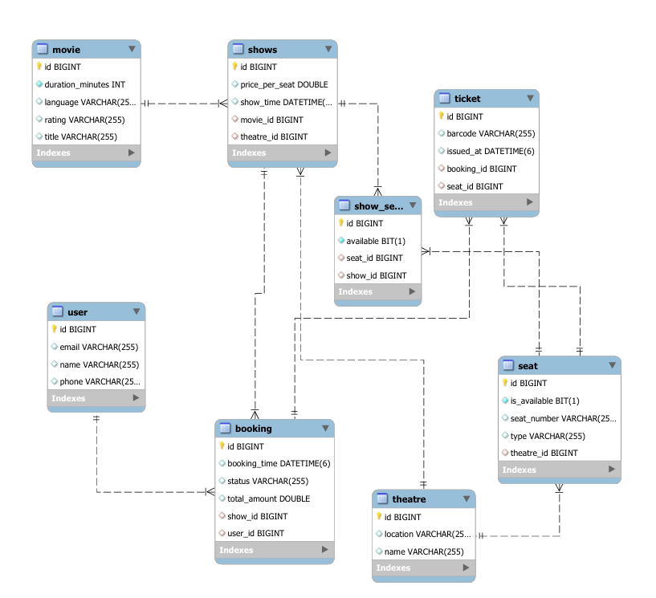

# Movie Ticket Booking Backend

Spring Boot REST API for managing movies, theatres, shows, seats, bookings, cancellations, and ticket barcode generation.

## Tech Stack

- Java 21
- Spring Boot
- Spring Web MVC
- Spring Data JPA
- Hibernate
- MySQL
- Bean Validation
- Swagger/OpenAPI
- JUnit 5 and Mockito

## Features

- Register users
- Create movies
- Create theatres with generated seat layouts
- Create shows for a movie and theatre
- View shows by movie
- View theatre seat layout
- View show-specific seat availability
- Book up to 9 seats in one request
- Prevent duplicate seat IDs in one booking
- Lock show seats during booking and cancellation to reduce double-booking risk
- Cancel bookings and release seats
- Generate barcode image data for booked tickets
- Centralized API error responses

## Configuration

The application reads database settings from environment variables. Defaults are provided for local development, but the password is intentionally not committed.

```properties
DB_URL=jdbc:mysql://localhost:3306/movie_ticket_booking
DB_USERNAME=root
DB_PASSWORD=your_password
DDL_AUTO=update
SHOW_SQL=false
```

See `src/main/resources/application-example.properties` for a sample config.

## Run Locally

```bash
set DB_PASSWORD=your_password
./mvnw spring-boot:run
```

On PowerShell:

```powershell
$env:DB_PASSWORD="your_password"
.\mvnw.cmd spring-boot:run
```

## API Endpoints

| Method | Endpoint | Description |
| --- | --- | --- |
| `POST` | `/users` | Register a user |
| `POST` | `/movies` | Create a movie |
| `GET` | `/movies` | List all movies |
| `POST` | `/theatres` | Create a theatre with seats |
| `POST` | `/shows` | Create a show |
| `GET` | `/shows/movie/{movieId}` | List shows by movie |
| `GET` | `/bookings/theatre/{theatreId}/seats` | View theatre seat layout |
| `GET` | `/bookings/shows/{showId}/seats` | View show-specific seat availability |
| `POST` | `/bookings` | Book seats |
| `GET` | `/bookings/{bookingId}` | View booking details |
| `DELETE` | `/bookings/{bookingId}` | Cancel a booking |

## Example Booking Request

```json
{
  "userId": 1,
  "showId": 2,
  "seatIds": [10, 11]
}
```

## Error Handling

The API returns structured error responses with appropriate HTTP statuses:

- `400 Bad Request` for validation and invalid booking requests
- `404 Not Found` for missing users, movies, shows, seats, or bookings
- `409 Conflict` for already-booked seats or already-cancelled bookings
- `500 Internal Server Error` for unexpected failures

## Testing

```bash
./mvnw test
```

Current tests cover duplicate-seat validation, already-booked seat handling, successful booking behavior, and application class availability.

## Entity Relationship Diagram



## Resume Highlight

This project demonstrates a layered Spring Boot backend with REST APIs, JPA persistence, DTO-based responses, validation, transaction management, concurrency-aware seat booking, centralized exception handling, and automated unit tests.
